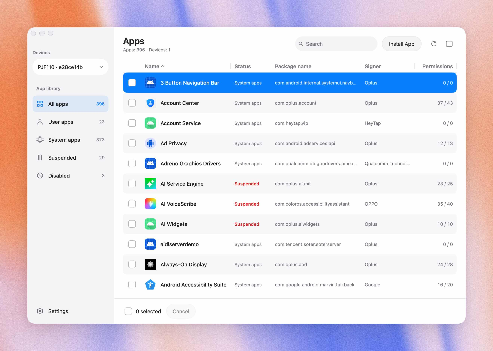

# App House

A macOS and Windows Android app manager built with [MyGo Native UI](https://mygo.egoist.dev/docs/ui).



The main window combines a device and category sidebar, a compact striped app table, and an optional permissions and signing inspector. Double-click an app row to open its details; use checkboxes to select apps for batch operations. The toolbar can hide the inspector again.

- Discover USB devices and manage wireless debugging pairing, connections, and disconnections.
- Mirror a device with scrcpy, record video, capture PNG screenshots, rotate the display, and send Back, Home, and Recent Apps commands.
- List installed apps for a selected Android user, including system, disabled, and suspended apps.
- Show icons, names, package names, versions, permission grants, signing subjects and organizations, and certificate SHA-256 fingerprints.
- Resize table columns and sort by clicking headers. The status column follows the app name; suspended and disabled states appear in red.
- View the selection count and clear selections in the taller bottom bar. Restore, Block, and Uninstall appear on its right only when apps are selected; app categories are in the sidebar.
- Right-click any app row to Restore, Block, or Uninstall it. Right-clicking a checked app targets the full checked selection, including filtered-out apps, and shows the count in the menu. Every action opens the same target confirmation used by the bottom bar.
- Search names, package names, signing information, and permissions; filter user, system, suspended, and disabled apps.
- Keep a persistent local history of every installation, uninstall, suspension, resume, enable, and disable result. History is grouped by `YYYY-MM-DD`, newest date first, with the time, device, Android user, and outcome for each app.
- Batch uninstall, block, or restore selected apps. Review the complete target list before execution, inspect individual results, and cancel remaining operations.
- Drag a standalone `.apk` into the main window, or click **Install App** in the top toolbar, to install it on the current device for the selected Android user. The app list refreshes when installation completes.
- Follow the desktop system language by default, with Chinese support and English fallback. Settings offers persistent **Follow system**, **English**, and **Chinese** choices.

## Run

Go 1.27.3 or newer is required. The compiled, read-only device inspector is included; Java and the Android SDK are not needed to build the desktop app.

```sh
go tool mygo dev
```

Connect a phone, enable USB debugging, and authorize this computer on the phone. A fixed-size device chooser opens at startup and remembers previous devices, including their manufacturer, model, product name, and Android version when available. Double-click an online device with a green indicator to enter the main window. Android 8.0 or newer is supported; wireless pairing requires Android 11 or newer. Use the dropdown at the top of the sidebar to switch devices. The lower-left Settings button opens a separate window for connections, Android users, ADB, language, and operation history. Device policy may restrict access to work profiles or other users.

Use a saved device's three-dot menu in the chooser or **Settings > Connect** to forget it. This removes its local saved entry without disconnecting an active device or deleting operation history. A device becomes remembered again when it reconnects.

ADB discovery checks `ANDROIDFUN_ADB`, bundled `platform-tools` beside the app (inside the app's Resources directory on macOS), development resources, PATH, and Android SDK locations, in that order. You can also choose an executable in **Settings > ADB**. Custom paths, remembered devices, and language preferences are stored in `AndroidFun/preferences.json` under the system user configuration directory. The configuration directory retains its original name for compatibility. Operation history is appended to `AndroidFun/history.jsonl` in the same directory (macOS: `~/Library/Application Support/AndroidFun/history.jsonl`; Windows: `%APPDATA%\AndroidFun\history.jsonl`). Each completed app operation is flushed to disk before the UI updates, including failed and canceled results. The history has no automatic retention limit. Unreadable records are reported without replacing the original file. History from versions that kept results only in memory cannot be recovered after those versions exit.

## Screen mirroring

Click **Mirror screen** in the main toolbar or a device's three-dot menu in the launcher. The device display and control rail share one resizable App House window. Click or drag on the display to tap or swipe on Android. Use the controls to start or stop recording, take a screenshot, rotate the display, or navigate Back, Home, and Recent Apps. Mirroring shows the device's foreground screen, independently of the app list's Android user filter. Android may hide protected content or reject input commands under device policy.

Screenshots (PNG) and recordings (MP4) save directly to Downloads by default. In **Settings > Mirroring**, choose another capture folder or enable **Ask where to save each time**; the save dialog also offers MKV recordings. Existing files are preserved. While recording, elapsed time appears below the recording button. Recording uses a separate scrcpy session, so stopping it keeps the mirror open. Capture results are saved to local operation history. Closing the mirror, switching devices, or quitting App House ends the sessions and finalizes recordings. Rotation controls require Android's `cmd window user-rotation`; the original rotation policy is restored when the session ends.

Mirroring settings are saved with the other preferences. They include **Stay awake** (`-w` / `--stay-awake`, while the device is plugged in), **Keep active** (`--keep-active`), turning off the device screen, always-on-top, audio, touch indicators, the desktop screensaver, maximum video size, frame rate, and video bit rate. New settings apply to the next session. Stay awake does not bypass a locked device's authentication.

scrcpy discovery checks a custom executable in Settings, `APPHOUSE_SCRCPY`, bundled platform resources, development resources, and installed scrcpy. Official packages include scrcpy **5.0.1**, its matching Android server, and its runtime dependencies. macOS selects the Intel or Apple Silicon binary automatically. App House passes the currently configured ADB executable and selected device explicitly to scrcpy. The embedded display uses a private local pipe and an FFmpeg decoder; no local streaming port is opened. FFmpeg discovery checks `APPHOUSE_FFMPEG`, bundled resources, development resources, and installed FFmpeg. Keyboard text entry and scrcpy keyboard shortcuts are not currently forwarded by the embedded display.

## Build and bundle device tools

```sh
# Download each platform's platform-tools from Google; requires Python 3.
python3 scripts/bundle-adb.py darwin
python3 scripts/bundle-adb.py windows

# Download checksum-pinned scrcpy releases, including both Mac architectures.
python3 scripts/bundle-scrcpy.py darwin
python3 scripts/bundle-scrcpy.py windows

# Build the minimal FFmpeg decoder on macOS (requires Xcode command-line tools).
python3 scripts/bundle-ffmpeg.py darwin
# Download the pinned Windows FFmpeg decoder.
python3 scripts/bundle-ffmpeg.py windows

# Alternatively, copy tools from a local SDK for the matching platform.
python3 scripts/bundle-adb.py darwin --from-sdk "$ANDROID_HOME/platform-tools"

# Build for Intel and Apple Silicon Macs, plus Windows x64.
go tool mygo build -platform darwin/universal,windows/amd64 -skip-dmg
```

The application outputs are `build/darwin-universal/App House.app` and `build/windows-amd64/App House.exe`. Portable archives are named `App-House-macOS.zip` and `App-House-Windows.zip`. Keep the `platform-tools`, `scrcpy`, and `ffmpeg` directories beside the executable when distributing the Windows portable app.

MyGo selects `resources/darwin` and `resources/windows` for the corresponding platforms. Downloaded tools are excluded from source control. The bundling script preserves ADB's `NOTICE.txt`, version, and source information, and supports `--url` and `--sha256` to pin an official archive. Building without bundled resources is also supported, but an existing ADB installation is then required at runtime.

The scrcpy bundler preserves the official portable archive contents, including its license, server, and supporting libraries, and writes the release source and SHA-256 to `origin.json`. Downloads are pinned to the hashes published by [scrcpy's macOS](https://github.com/Genymobile/scrcpy/blob/v5.0.1/doc/macos.md) and [Windows](https://github.com/Genymobile/scrcpy/blob/v5.0.1/doc/windows.md) installation documentation. For offline builds, pass `--archive` with the original official filename; on macOS, pass it twice for the `aarch64` and `x86_64` archives. The same checksum verification applies to local archives. Without bundled scrcpy, install it separately or select a custom executable in Settings.

The FFmpeg bundler builds a minimal LGPL decoder for Apple Silicon and Intel Macs from checksum-pinned [official FFmpeg 9.0.2 source](https://ffmpeg.org/releases/ffmpeg-9.0.2.tar.xz). Only the H.264/Matroska decoding, scaling, and MJPEG frame output needed by the embedded mirror are enabled; external library detection, networking, GPL, and nonfree components are disabled. Each binary includes its complete source archive, LGPL license, and reproducible commands in `BUILD.json`.

Windows uses the x64 GPL build from the third-party [ffmpeg-static `b6.1.1` release](https://github.com/eugeneware/ffmpeg-static/releases/tag/b6.1.1), verified against GitHub's published SHA-256. Its original builder is Gyan; upstream README, license, full GPLv3 text, and source references are preserved. Both platforms record provenance in `origin.json` and `SOURCE.txt`. For offline builds, use `--from-directory`: supply `ffmpeg-9.0.2.tar.xz` for macOS, or `ffmpeg-win32-x64.gz`, `win32-x64.LICENSE`, and `win32-x64.README` for Windows.

On macOS, omit `-skip-dmg` to create a DMG. Windows installers require NSIS. The default artifacts are not Developer ID notarized or Windows code signed; see [MyGo's distribution documentation](https://mygo.egoist.dev/docs/distribution) for signing configuration.

## GitHub releases

The [Release workflow](.github/workflows/release.yml) builds a universal macOS DMG (Intel and Apple Silicon) and a Windows x64 installer EXE, both with bundled ADB, scrcpy, and FFmpeg. Each platform runs tests and static checks before building. MyGo downloads NSIS on the Windows runner when needed.

To publish, update `version` as needed and increment `buildVersion` in `mygo.json`, commit the change, and push a matching `v<version>-<buildVersion>` tag (for example, `v0.1.0-1`). The workflow rejects tags that do not match the configured version and build number. Once both builds succeed, a separate job publishes the installers to a GitHub Release using the built-in `GITHUB_TOKEN`; no additional secrets are required.

You can also select **Actions > Release > Run workflow** to build downloadable artifacts without publishing a release. Outputs are `app-house-<version>.dmg` and `app-house-setup-<version>-amd64.exe`. These builds use ad hoc macOS signing without notarization and no Windows code signing.

## Operation behavior

- **Install App:** installs a standalone APK on the current device for the selected Android user. The `-r` option allows updates while preserving existing app data. Installation does not automatically grant runtime permissions or allow version downgrades. Split APK sets, `.apks`, and `.xapk` bundles are not supported. The app list refreshes after completion.
- **Uninstall:** runs `pm uninstall --user <ID> <package>`, removing the app and its data for that user. Preinstalled APKs on the system partition remain. Restoring a preinstalled package does not guarantee recovery of its data.
- **Block:** first runs `pm suspend --user <ID> <package>`. If the device reports that the command is unsupported (as on some Android TVs), it automatically uses `pm disable-user` for the same package and user. Data is preserved. Permission refusals, disconnects, and cancellation remain errors.
- **Restore:** clears suspension with `pm unsuspend` or re-enables a disabled app with `pm enable`, according to its state. Apps that are both suspended and disabled need both steps. History records the concrete operation, and partial successes are retained if the next step fails.
- Filtering does not clear existing selections. The confirmation window includes every selected app, including entries hidden by filters.
- Cancellation does not undo completed operations. If the device disconnects or a command is canceled during execution, refresh the list to verify the device's state.
- Permission information consists of PackageManager's requested permissions and grant flags. It does not show whether an app has used a permission and does not cover AppOps overrides or one-time access state.
- Author and company information comes from self-declared signing certificate fields, which may be empty. It is not a verified developer identity. The app shows current APK signing certificates, not the complete key rotation history.

Metadata is read by the embedded `inspector.jar` through `adb shell app_process`. The inspector is copied to the device's temporary directory; it does not install an APK or require root. See [device/README.md](device/README.md) for its source and reproducible build instructions. Android hidden APIs and vendor policies can affect inspection; errors are displayed in the interface.

## Validation

```sh
go test -race ./...
go vet ./...
```

Tests cover command injection protection, device and user scoping, failure output, inventory completeness, search, selection, and operation confirmation. Explicitly set `ANDROIDFUN_TEST_DEVICE` to enable read-only integration checks on a real device; those checks do not uninstall or suspend apps.

References: [ADB documentation](https://developer.android.com/tools/adb) and [SDK Platform-Tools](https://developer.android.com/tools/releases/platform-tools).
